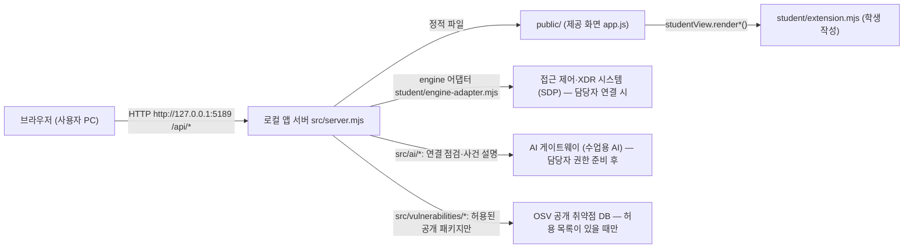

# 케셰브 학생용 실행 설명서

이 문서는 학생이 작성한 설명서입니다. 제공 문서(`README.md`, `docs/GETTING_STARTED_STUDENT.md` 등)는 수정하지 않았습니다. 명령과 경로는 현재 `package.json`, `tools/start-alekov.ps1`, `src/server.mjs`, `.env.example`을 읽고 적었으며, 직접 실행해 확인한 것과 코드·문서만 읽은 것을 5장 표에서 구분합니다. 비밀 값(열쇠·토큰·비밀번호)은 이 문서에 적지 않습니다.

## 1. 목적과 기능

「케셰브」는 회사 직원이 자기 로그인 상태, 업무 앱 접속 판정, 접속 기록·XDR 경보, 설치 패키지의 알려진 취약점 조회 결과를 보는 보안 앱입니다. 학생은 `student/extension.mjs`의 화면 함수만 구현합니다. 서버·제공 화면·판정 코드는 제공된 그대로 둡니다.

## 2. 필요한 프로그램과 버전

| 항목 | 값 | 근거 |
|---|---|---|
| Node.js | 24.19.0 이상(`package.json`의 `engines`는 24.19.0, 제공 문서는 22~24 지원·검사 기준 24.19.0). 이 작업 PC는 24.22 | 작업 PC에서 설치 후 실행 확인 |
| 외부 npm 의존성 | 없음(`npm install` 불필요) | `package.json`에 dependencies 없음 |
| PowerShell | Windows PowerShell | 실행 도구가 `.ps1` |
| 브라우저 | PC 브라우저 | 주소는 3장 |
| Git | 커밋·제출용 | 저장소: https://github.com/minsanghwang/aleph-qesheb |

## 3. 폴더 구조와 작업 위치

작업 위치(앱 폴더)는 저장소 안의 `on-client`입니다(`package.json`이 있는 폴더). PowerShell은 이 폴더에서 엽니다. 상위 경로는 PC마다 다르므로 문서에 고정하지 않습니다.

```text
on-client/
├─ package.json            실행 스크립트(start / demo / check)
├─ .env.example            비밀 없는 설정 견본(ON_PORT 등)
├─ README.md               제공 문서
├─ docs/                   제공 문서 + STUDENT_RUNBOOK.md(이 문서)
├─ public/                 제공 화면(index.html, app.js, style.css 등)
├─ src/                    제공 서버(server.mjs, engine, ai, actions, vulnerabilities …)
├─ student/
│  ├─ extension.mjs        학생 작성: 화면 함수 (13~20단계)
│  └─ engine-adapter.mjs   제공 어댑터
└─ tools/start-alekov.ps1  제공 실행 도구
```

## 4. 실행·종료·재실행

실행(앱 폴더의 PowerShell, 예제 자료 화면):

```powershell
npm.cmd run demo
```

- 이 명령은 `node src/server.mjs --demo`를 실행합니다. 예제 자료이며 실제 회사 시스템 연결이 아닙니다.
- 일반 실행 `npm.cmd start`와 제공 실행 도구 `powershell -NoProfile -ExecutionPolicy Bypass -File .\tools\start-alekov.ps1`은 `README.md`와 `package.json`에 적힌 명령입니다.
- 문법만 확인: `npm.cmd run check`(`node --check student/extension.mjs`).

| 항목 | 내용 |
|---|---|
| 브라우저 주소 | http://127.0.0.1:5189 (기본 포트 5189, `ON_PORT`로 변경 가능. 서버는 127.0.0.1에만 바인딩) |
| 정상 시작 신호 | PowerShell에 `케셰브 예제: http://127.0.0.1:5189`(demo) 또는 `케셰브 연결 확인: http://127.0.0.1:5189` 출력, 브라우저에 「예제 데이터(demo) · 실제 연결 아님」 배지 |
| 종료 | 서버를 켠 PowerShell 창에서 `Ctrl+C` |
| 재실행 | 종료 후 같은 명령을 다시 실행. 포트 사용 중이면 이전 서버가 꺼졌는지 확인하고, 필요하면 `-Port 5190`(실행 도구) 또는 `ON_PORT` 사용 |
| Node 버전 오류 | `ERR_UNKNOWN_BUILTIN_MODULE node:sqlite` → `node --version`이 24 이상인지 확인 후 새 PowerShell 창에서 재실행 |

## 5. 시스템 구성도



글로 쓴 같은 내용:

| 구간 | 방향 | 주소·경로 | 설명 |
|---|---|---|---|
| 브라우저 → 로컬 앱 서버 | 요청 | `http://127.0.0.1:5189` 의 `/api/me`, `/api/devices`, `/api/sessions`, `/api/events`, `/api/apps`, `/api/access`, `/api/diagnostics`, `/api/ai/check`, `/api/ai/explain`, `/api/actions/prepare·execute·result`, `/api/vulnerabilities` | 서버는 `127.0.0.1`에만 열립니다 |
| 로컬 앱 서버 → 화면 | 파일 | `public/index.html`, `public/app.js` | 제공 화면이 서버 응답을 받아 `student/extension.mjs`의 함수에 넘깁니다 |
| 화면 → 학생 함수 | 호출 | `renderIdentity/Decision/Events/Status/AiConnection/Explanation/Action/Vulnerabilities` | 학생 함수는 DOM만 만들고 서버를 직접 부르지 않습니다 |
| 로컬 앱 서버 → 접근 제어·XDR | 요청 | `student/engine-adapter.mjs`, `src/engine/sdp-host.mjs` | demo 모드는 예제 엔진을 사용합니다 |
| 로컬 앱 서버 → AI 게이트웨이 | 요청 | `src/ai/*` | 앱 안에서 주소·열쇠를 입력하지 않으며, 연결은 계정 연결·앱 승인 후 가능합니다 |
| 로컬 앱 서버 → OSV | 요청 | `src/vulnerabilities/*` | 허용 목록(`ON_APPROVED_PUBLIC_PACKAGES`)이 비어 있으면 외부 조회하지 않습니다 |

설정은 `.env.example`의 비밀 없는 항목(`ON_PORT`, `ON_ENGINE_ADAPTER`, `ON_AI_MODEL`, `ON_PROJECT_DIRECTORY`, `ON_APPROVED_PUBLIC_PACKAGES`)만 문서화합니다. 실제 값은 `.env` 등 제출에서 빠지는 파일에만 둡니다.

## 6. 제공 부분과 학생 작성 부분

| 구분 | 파일 | 내용 |
|---|---|---|
| 제공(수정 안 함) | `src/**`, `public/**`, `tools/**`, `student/engine-adapter.mjs`, 기존 `docs/**`, `README.md` | 서버, 화면, 입력 검증, 계정·AI 연결, 실행 도구 |
| 학생 작성 | `student/extension.mjs` | 아래 함수 8개 |
| 학생 작성 | `docs/STUDENT_RUNBOOK.md` | 이 문서 |

## 7. 구현한 함수와 확인 상태

확인 구분: **화면** = 예제 자료(demo)로 서버를 켜고 브라우저 화면에서 확인, **모의** = 코드로 만든 모의 입력(jsdom)으로 확인, **코드** = 코드·문서를 읽은 것, **추가 확인 필요** = 이 환경에서 실행해 확인하지 않은 것.

| 단계 | 함수 | 하는 일 | 확인 |
|---|---|---|---|
| 13 | `renderIdentity` | 로그인 사용자·기기·세션 | 화면, 모의 |
| 14 | `renderDecision` | 업무 앱 접속 판정(허용·거부·추가 확인·확인 불가) | 화면, 모의 |
| 15 | `renderEvents` | 접속 기록·XDR 경보 목록, 필터, 상세 | 화면(예제 1건), 모의(여러 건 필터) |
| 16 | `renderStatus` | 기기·세션·알림·진단, 「도움정보 복사」, 미지원 조치 비활성 버튼 | 화면(서버 중지 시 오류 포함), 모의 |
| 17 | `renderAiConnection`, `renderExplanation` | AI 연결 점검 상태, 원인별 안내 | 화면(연결 점검 실패 화면), 모의 |
| 18 | `renderExplanation` | 근거·규칙·확인 불가 상태·제안과 함께 AI 설명 | 모의 |
| 19 | `renderAction` | 제안·접수(ACK)·효과 확인 구분 | 모의 |
| 20 | `renderVulnerabilities` | 정확한 설치 버전과 OSV 조회 결과, 부분 실패 | 모의 |

포털의 AI 판정 결과는 단계 제출 후 서버 화면에서 확인합니다. 이 문서는 통과 여부를 기록하지 않습니다.

## 8. 오류별 확인 순서

| 증상 | 확인 순서 | 복구 |
|---|---|---|
| 브라우저가 열리지 않음(`ERR_CONNECTION_REFUSED`) | ① 서버 PowerShell 창이 켜져 있는지 ② 시작 신호가 출력됐는지 ③ 주소·포트 | 앱 폴더에서 서버 재실행 |
| `ERR_UNKNOWN_BUILTIN_MODULE node:sqlite` | `node --version` | Node.js 24 설치 후 새 PowerShell 창 |
| 포트 사용 중 | 이전 서버 창 확인 | 이전 서버 `Ctrl+C` 또는 다른 포트 지정 |
| 화면에 「연결 실패」「확인 불가」 | 안내 문구의 code(`CONTRACT_MISMATCH`, `ENGINE_RESULT_UNVERIFIED` 등) 확인 후 「다시 불러오기」를 직접 누름 | `docs/CONNECTION_TROUBLESHOOT.md`의 코드표 |
| 계정 연결 `NATIVE_HOST_DISABLED` | demo 실행인지 확인 | 담당자가 안내한 일반 실행으로 재시작 |
| AI 연결 점검 「권한 준비 중 또는 확인 불가」 | 계정 연결·앱 권한 준비 여부 | 담당자에게 확인 요청(학생 설정 변경 없음) |
| 취약점 조회 `not_configured`·`not_checked` | 허용 목록 준비 여부 | 담당자 준비 후 직접 다시 조회 |
| 문법 오류 | `npm.cmd run check` | `student/extension.mjs` 수정 |

학생 화면은 오류 때 자동으로 다시 요청하지 않으며, 다시 시도는 사용자가 제공 버튼을 눌러 시작합니다.

## 9. 지원 범위와 추가 확인이 필요한 항목

| 항목 | 상태 |
|---|---|
| Windows + Node.js 24.22, demo 실행, 브라우저 화면 | 확인함 |
| 일반 실행(`npm.cmd start`)·`tools/start-alekov.ps1` | 코드·문서로 확인. 이 작업에서는 실행하지 않음(추가 확인 필요) |
| 실제 회사 시스템(SDP)·계정 연결·AI 앱 승인·모델 점검 | 담당자 권한 준비 후 확인 대상 |
| 실제 AI 사건 설명 성공 경로 | 모의 입력으로만 확인. 실제 호출은 하지 않음 |
| 보안 조치 집행 경로(`renderAction`의 prepared~succeeded) | 현재 기록의 지원 조치가 없어 모의 입력으로만 확인 |
| OSV 실제 조회 결과 | 허용 목록 준비 후 확인 대상 |
| Windows 이외 환경 | 지원 범위 밖으로 보고 확인하지 않음 |

## 10. 제출 순서(21·22단계)

1. 이 문서와 해당 단계 코드를 같은 커밋에 저장하고, 기존 변경이 있으면 먼저 내용을 확인합니다.
2. 과제 화면에 저장소 주소와 40자리 커밋을 입력합니다.
3. 비공개 저장소라면 과제 화면의 「비공개 저장소 원문 준비 방법」의 안내에 따라 `student-source-cli.mjs` 도구를 사용합니다(경로는 본인 PC에 맞게 지정).
4. 원문 전달 완료와 AI 검토 통과는 다르므로 서버 상태와 판정 설명을 확인합니다.
